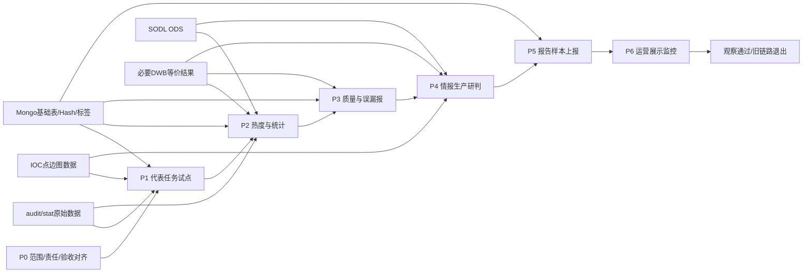

# 业务分类迁移计划（917版）

更新日期：2026-09-22  
任务基线：《大数据平台YARN上的任务梳理-云脑大数据平台-917梳理.csv》  
计划状态：执行建议稿，任务切流、停服和责任划分仍以业务签字及变更审批为准。

## 1. 一页结论

本项目按业务领域组织负责人、验收场景和迁移批次，按技术依赖决定任务实际放行顺序。不能把45项任务简单排成一条串行队列，也不能等全部公共数据准备完成后再统一开始。

推荐执行主线为：

```text
P0 范围与退出对齐
  → P1 三类代表任务试点
  → P2 热度/统计库
  → P3 情报质量与误漏报
  → P4 情报生产、研判与分发
  → P5 报告、样本与对外上报
  → P6 运营展示与运行监控
  → 分批观察、旧链路退出
```

与此同时，公共数据接入、加工与维护作为并行交付泳道，按业务批次提前交付audit/stat、SODL ODS、必要DWB等价结果、Mongo基础表、Hash、IOC点边表等输入。某批输入未就绪时，只顺延受影响任务，不阻塞其他已具备条件的任务。

关键原则：

1. **先减范围再改代码**：先处理可下线、待确认、已下线及混合状态任务，避免无效迁移。
2. **先验证代表链路再批量复制**：首批同时覆盖单表查询、stat聚合、audit联表三种典型形态。
3. **业务分类负责验收，技术依赖负责放行**：同一业务组内允许分支分批完成，不要求整组同时切。
4. **新旧SQL先锁定等价输入**：固定时间窗口、数据截止点和动态维表版本，输入摘要一致后再比较业务结果。
5. **离线对账通过后才能受控线上验证**：线上写入先用影子目标；同一生产范围切流时保持单一写者。

## 2. 范围基线

917材料按服务名去重后共45项：纯保留25项、纯可下线11项、纯待确认4项、纯已下线3项、混合状态2项。45项是盘点全集，不等于45项都要实施迁移。

| 业务领域 | 盘点数 | 本计划处理方式 |
|---|---:|---|
| 情报生产、研判与分发 | 12 | P1试点＋P4主体迁移；旁路分发任务先判断是否需要改造 |
| 情报质量与误报漏报治理 | 4 | P3；其中`phishing-url-operation-prc`按既有决策退出 |
| 热度、活跃度与统计库生产 | 5 | P1试点＋P2主体迁移 |
| 运营展示与运行监控 | 6 | P1试点＋P6后批迁移；已下线/可下线项先核实 |
| 报告、样本查询与对外上报 | 5 | P5；先确认3项去留 |
| 资产发现与漏洞关联 | 2 | P0退出核定，不进入默认改造队列 |
| 公共数据接入、加工与维护 | 10 | 贯穿各批次的公共依赖泳道，逐子任务交付或退出 |
| 业务用途待确认 | 1 | 已下线核实后归档 |
| **合计** | **45** | 按状态和依赖逐项收口 |

## 3. 端到端执行结构



图中的P1至P6表示业务优先级，不表示强制全串行。如果P4某项输入已经就绪，而P3某项被DWB阻塞，可以先推进P4已就绪项。

## 4. P0：范围、责任与退出对齐

### 4.1 目标

在开发前确定每项是“迁移、仅验收新供数、无需改造、退出、待确认”中的哪一种，并锁定生产者、任务负责人、业务验收人和完成日期。

### 4.2 处理清单

- 11项纯可下线：移入退出验证队列，不默认实施SQL改造，也不视为已批准停服。
- 4项纯待确认：`cert-app-samplesync-job`、`ti-ip-detection-send-prc`、`ti-hot-data-detection-fusing-prc`、`black-file-clean-cronjob`，限期确认去留。
- 3项纯已下线：核实现网实例、共享输出和残留调度后归档。
- 2项混合状态：`soapa-logger-stream-prc`、`log_compress`必须拆到子任务或调度实例，不允许按整个服务停用。
- 已确认退出：`phishing-url-operation-prc`按DEC-004推进，但停服前仍需确认Mongo输出读取者和恢复方案。

### 4.3 完成门槛 M0

- 45项逐项有处置状态，不以空白代替结论。
- 所有保留项均有业务负责人、技术负责人、验收人、输入表、输出目标和SLA。
- 可下线项有读取者核查、批准人和计划日期；替代供数型服务有“先验收新链路、后退旧链路”的依赖关系。
- 数据湖交付清单明确目标表名、字段映射、历史范围、增量机制、数据截止点和交付日期。

## 5. 公共数据接入与加工：并行前置泳道

这10项不构成一个最后执行的业务批次，而是为P1至P6提供输入。

| 公共任务 | 917状态/方向 | 迁移处置 | 退出门槛 |
|---|---|---|---|
| `soapa-logger-stream-prc` | 混合 | ES保留分支单独管理；HDFS等可退分支逐项核定 | 保留分支持续可用，可退分支无消费者 |
| `secevent-to-hive-stream-prc` | 可下线 | 由新audit/stat供数替代 | 新表历史、增量、完整性和下游验收通过 |
| `secevent-to-hive-batch` | 已下线 | 核实后归档 | 无现网实例及残留消费者 |
| `sync-mongo2hive-job` | 可下线 | 不迁旧服务；新Hash供数由数据湖承接 | Hash字段、增删改、历史及下游SQL验收通过 |
| `sodl_ods_info` | 保留方向 | 交付SODL接入日志或等价新表 | 六类日志按实际范围完成字段、分区/时间、产量验收 |
| `sodl_dwb_info` | 保留方向 | 仅重建仍有保留消费者的加工语义 | 输入到DWB结果分层对账通过 |
| `log_compress` | 混合/取消压缩过程 | 新平台不原样重建压缩表；为保留下游提供原始表改读或等价加工 | 所有保留消费者性能和结果通过后退旧压缩调度 |
| `datax-server` | 可下线 | 逐表改由新Mongo→平台供数承接 | 每张仍需表完成全量、增量、删除和时效验收 |
| `create_hive_partition` | 保留盘点 | StarRocks下不照搬Hive分区创建，核定是否存在替代维护动作 | 所有保留任务不再依赖旧Hive分区创建 |
| `secevent-to-hive-partition-pruned-cron-job` | 可下线 | 不迁Hive分区修剪逻辑 | 确认新平台无需等价任务且旧消费者已退出 |

公共交付优先级按受影响业务倒排：P1所需输入最先，P2/P3所需DWB和SODL紧随，P4/P5/P6按任务交付时间滚动补齐。

## 6. P1：首批代表任务试点

首批建议不是只选“最简单任务”，而是用3项覆盖迁移中最常见的风险类型。

| 顺序 | 任务 | 业务领域 | 代表性 | 前置条件 | 验收结果 |
|---:|---|---|---|---|---|
| 1 | `gnn-domain-hive-query-cronjob` | 情报生产 | 单表、单SQL、Redis输出 | IOC点表`csc.ods_csc_ioc_vertex`新表及Redis影子目标可用 | 查询业务键一致、Redis写入/读回和业务读取通过 |
| 2 | `cipd-product-resource-monitor-prc` | 运营监控 | stat查询、VARCHAR数值聚合、Prometheus输出 | stat原始数据、类型解析规则和隔离指标目标可用 | 7条统计结果、耗时及指标读回通过 |
| 3 | `filter-layout-ip-seg-stat-prc` | 热度统计 | audit＋IP信誉联表、原始替代压缩、Redis输出 | audit原始表、IP信誉快照、固定7日窗口可用 | 输入摘要、网段结果、性能及Redis读回通过 |

若IOC点表未按时交付，第一项只完成SQL改造而不切流，第二、三项不等待。首批完成后形成SQL改造模板、VARCHAR解析模板、自动对账模板、影子输出规范、回滚步骤和单位任务实测工时。

### 完成门槛 M1

- 三类代表链路至少各有一项完成离线对账；具备条件的任务完成影子输出E2E。
- 无未解释的关键差异，解析失败率、性能和资源消耗满足约定。
- 自动化工具能够批量替换连接/表映射、注入固定参数、采集结果并生成差异报告；不做无差别全局字符串替换。
- 试点结果用于校正执行阶段10人天预算及后续批次日期。

## 7. P2：热度、活跃度与统计库生产（5项）

| 任务 | 建议子顺序 | 关键前置 | 主要验证方式 |
|---|---:|---|---|
| `filter-layout-ip-seg-stat-prc` | 1，已在P1试点 | audit原始表、IP信誉快照 | 固定7日窗口，输入摘要＋网段结果＋Redis读回 |
| `topthreat_hot_stat` | 2 | audit；URL/Domain分支另需SODL ODS | 3条SQL分支分别验收，先MD5、后URL/Domain，不以部分成功代替整任务完成 |
| `top-visit-host-produce-job` | 3 | IP分支输入；其余分支按实际SODL依赖 | Top N并列边界、去重、Redis/过滤包读取验收 |
| `domain-heat-stats-cron-job` | 4 | SODL DWB或等价Domain模型 | 分层对账，验证聚合口径、热度值和Mongo读回 |
| `black-ti-context-produce-prc` | 5 | 必要DWB、信誉/标签等动态维表 | 固定维表快照，验证IOC活跃统计及Mongo/Redis读回 |

### 完成门槛 M2

- 5项均有迁移或明确退出结论；保留项所有业务分支均通过，不以“主SQL已跑通”掩盖缺失分支。
- 压缩表改读原始表的结果、扫描量、执行时间和峰值资源通过实测。
- 热度/统计结果在实际消费端可读，满足产出时点和新鲜度SLA。

## 8. P3：情报质量与误报漏报治理（4项）

| 任务 | 状态 | 关键前置与处置 |
|---|---|---|
| `ati-pdns-cache-job` | 保留盘点 | IOC点表、DNS相关输入和Mongo/Redis影子目标就绪后迁移 |
| `domain-hit-devnum-cronjob` | 保留盘点 | Domain DWB等价结果先验收，再校验设备数聚合和Mongo结果 |
| `black-file-clean-cronjob` | 待确认 | 先确定业务仍在使用；保留时交付MD5等价模型和文件云接口测试条件 |
| `phishing-url-operation-prc` | 已确认下线，待实施 | 不进入改造队列；核对Mongo输出读取者、停调度和恢复窗口 |

### 完成门槛 M3

- 保留项用真实误报/漏报场景验收，而不只比较总行数。
- Mongo/Redis目标完成业务键、字段值、TTL/更新覆盖及实际读取校验。
- 退出项完成读取者确认和变更审批，具备回退条件后停服。

## 9. P4：情报生产、研判与分发（12项）

本组按技术依赖拆成四个子批，不宜12项同时切换。

### P4.1 图数据与单表任务

- `ati-relations-loader-job`：负责生产IOC点表`csc.ods_csc_ioc_vertex`和边表`csc.ods_csc_ioc_edge`，先明确新平台生产责任、点边结构和增量语义。
- `gnn-domain-hive-query-cronjob`：已在P1试点，依赖点表交付。

### P4.2 SODL ODS直接消费

- `domain-security-log-etl-prc`
- `ip-security-log-etl-prc`
- `attack-ip-analysis-cronjob`

三项在相应SODL日志、动态维表和目标Mongo/Redis条件就绪后迁移，逐层校验过滤、规则命中、去重及真实输出。

### P4.3 DWB或混合来源

- `active-domain-elt-job`：先确认所需DWB/基础表的等价模型，再执行回扫结果和外部接口验证。
- `apt-hunting-monitor-process-job`：917标注可下线，先确认RETRO IP/Domain/MD5/URL监控结果是否仍有使用方，不默认改造。
- `ti-ip-detection-send-prc`、`ti-hot-data-detection-fusing-prc`：均为待确认，业务确认保留后再补目标数据源和验收场景。

### P4.4 旁路情报分发

- `ip-intelligence-dispatch-prc`
- `dns-intelligence-dispatch-prc`
- `url-intelligence-dispatch-prc`

若三项只消费Kafka/Pulsar等旁路数据、无Hive/SR查询，则不计入StarRocks SQL改造工作量，但仍要验证其上游消息未因平台迁移中断。若实际存在动态SQL或未披露的平台依赖，再纳入改造。

### 完成门槛 M4

- 点边图数据、SODL ODS、必要DWB和外部维表均有生产责任人及交付证据。
- 保留的生产任务完成结果、目标端读回和真实情报消费场景验收。
- 旁路任务形成“无需改造但已做影响验证”的结论；待确认/可下线项有正式处置结论。

## 10. P5：报告、样本查询与对外上报（5项）

| 任务 | 当前状态 | 计划 |
|---|---|---|
| `ctig-report-data-analysis-prc` | 保留盘点 | 依赖基础表/维表交付后迁移，按报告指标和样本明细验收 |
| `cert-app-samplesync-country-job` | 保留盘点 | 固定上报窗口和数据截止点，验证文件/接口接收结果 |
| `cert-app-samplesync-job` | 待确认 | 先确认对外报送是否仍运行，再决定迁移或退出 |
| `yara-sample-query-job` | 可下线 | 核对查询入口、用户和最后运行记录后退出或恢复为迁移项 |
| `sp-old-update-report-cron-job` | 可下线 | 核对上报中台接收方和最后成功运行记录后退出或恢复为迁移项 |

### 完成门槛 M5

- 对外输出由接收方签字，覆盖条数、字段、文件/接口格式、截止时间和重复发送语义。
- 所有可下线/待确认任务完成去留审批，不遗留隐性上报责任。

## 11. P6：运营展示与运行监控（6项）

运营展示作为最后一批业务迁移，是因为其依赖上游统计口径稳定；但迁移监控能力必须在P1前就绪。

| 任务 | 当前状态 | 计划 |
|---|---|---|
| `online-dev-warehousing-prc` | 保留盘点 | 上游在线设备数据稳定后迁移，验证展示端读取 |
| `cloud-display-manager-prc` | 保留盘点 | 上游指标稳定后迁移，验证运营页面/接口 |
| `dashboard-stats-job` | 保留盘点 | 固定动态维表快照，逐指标对账公司大屏 |
| `cipd-product-resource-monitor-prc` | 保留，P1试点 | 试点完成后纳入本领域验收收口，不重复计数 |
| `svd-activity-stat-job` | 可下线 | 确认漏洞/规则活跃度读取者后决定退出或迁移 |
| `thug-task-monitor-prc` | 已下线 | 核实现网实例后归档，不恢复迁移 |

### 完成门槛 M6

- 运营指标、页面或告警在实际使用端验收，不能只验数据库结果。
- 迁移监控覆盖任务成功率、延迟、数据量、解析失败、目标写入失败和业务读取异常。
- 所有业务批次均有最终处置结论，无未披露旧Hive查询。

## 12. 每批统一执行模板

每项任务按以下顺序推进，前一步未通过不得跳到生产切流：

1. **预检**：确认任务去留、旧/新表映射、目标DDL与VARCHAR实际编码、账号权限、输出目标和验收人。
2. **SQL/代码适配**：连接与表名映射 → Hive/Trino/StarRocks方言适配 → VARCHAR显式解析 → 必要业务逻辑改造。
3. **锁定输入**：把动态日期解析为具体值，固定时区、迟到数据截止点和维表快照。
4. **离线分层对账**：比较输入摘要、过滤/解析中间结果、最终业务键和值；差异分类为`MATCH`、`OLD_ONLY`、`NEW_ONLY`、`VALUE_DIFFERENT`、`PARSE_FAILED`、`INPUT_MISSING/DIFFERENT`。
5. **性能验证**：记录扫描量、耗时、并发、峰值资源；原始替代压缩必须使用生产规模窗口实测。
6. **受控线上验证**：新任务写影子Mongo/Redis/Kafka/Prometheus目标，完成写入、读回和实际业务读取。
7. **切流与回滚准备**：固定切流批次/位点，同范围单一写者；保留旧任务、输入和恢复能力。
8. **观察与收口**：每批观察至少7个自然日；异常时停新写、恢复或补偿目标数据、恢复旧任务并补做边界对账。

## 13. 排期和资源口径

沿用已有三阶段计划的初始预算：前期准备串行口径13.5个工作日，执行改造预算10人天，每批切换后观察不少于7个自然日。这里的10人天是总工作量预算，不是固定10个日历日；首批实测后必须重估。

建议时间组织如下：

| 时间段 | 主工作 | 可并行工作 | 阶段结果 |
|---|---|---|---|
| 准备期 | P0范围/责任/验收对齐 | 公共表交付、账号网络、对账工具和影子目标准备 | M0 |
| 试点期 | P1三类代表任务 | P2/P3依赖补齐、待确认任务业务签字 | M1 |
| 主迁移期A | P2热度统计、P3质量治理 | P4中已就绪的图数据/SODL任务 | M2、M3 |
| 主迁移期B | P4情报生产、P5报告上报 | P6上游指标预校验 | M4、M5 |
| 收口期 | P6运营展示、全量依赖扫描 | 分批观察、退出审批和恢复演练 | M6 |
| 退出期 | 停旧任务、撤旧权限/资源 | 文档归档和运营交接 | M7 |

## 14. 项目完成画面与最终里程碑 M7

项目完成时应能看到：

- 每个确认保留的业务任务均从新平台读取，真实业务端持续可用，结果、时效和性能有验收证据。
- 新平台不再依赖旧压缩任务；必要语义已由原始表SQL或共享加工承接，且经过生产规模验证。
- audit/stat、SODL、Mongo基础表、Hash、标签和IOC点边表均有明确生产者、数据契约、SLA和告警。
- Mongo/Redis/Kafka/Prometheus等下游不仅“写成功”，还能读回且由实际业务用例验收。
- 所有可下线、待确认、混合状态任务均有最终结论；无未披露旧Hive SQL、调度或供数依赖。
- 旧任务在观察期和回滚窗口结束后按审批退出，平台全局下线仍由数据湖统筹，不由本项目单独承诺。

## 15. 主要风险与提效抓手

| 主要风险/耗时点 | 控制方式 | 提效方式 |
|---|---|---|
| 业务去留和验收人不清 | P0限期签字，未确认项不进入默认改造队列 | 先减少无效迁移范围 |
| 数据湖交付晚或字段格式不稳定 | 逐表数据契约、样本、截止点和交付门槛 | 按批次倒排交付，不等待所有表齐备 |
| 全字段VARCHAR导致过滤、聚合、排序和JOIN错误 | 建立字段编码—业务类型—解析表达式映射 | 统一兼容视图/转换模板，批量扫描SQL |
| 取消压缩表后性能退化 | 原始表等价投影和生产规模压测 | 共享加工复用，避免各任务重复扫描解析 |
| DWB逻辑复杂，最终结果差异难定位 | 输入→解析→中间结果→输出分层对账 | 自动生成输入摘要和差异分类报告 |
| Mongo/Redis/Kafka结果难验证和回滚 | 影子目标、读回、实际业务用例、单一写者 | 同类目标端复用验收脚本和回滚模板 |
| 动态维表和迟到数据造成假差异 | 固定快照和完整截止点 | 参数清单自动生成，批量执行同窗口SQL |

## 16. 证据边界与待确认项

- 本文的任务数量、领域和917状态来自现有盘点材料；“可下线”不是正式停服批准。
- P1三项为既有首批建议，尚未自动升级为生产切流决定。
- 各任务的目标StarRocks物理表名、所有字段实际编码、数据湖交付日期、业务负责人和验收人尚未全部确认。
- 执行阶段10人天需在P1后基于实测校正；数据湖接入开发、历史回填、审批等待和每批7日观察不应混入该人天预算。
- 本计划不授权生产查询、写入、停调度、删表或撤销权限；具体动作按变更流程审批。

## 17. 关联材料

- [迁移任务按业务领域分类-917更新版](./迁移任务按业务领域分类-917更新版.md)
- [迁移事项进度与决策追踪](./迁移事项进度与决策追踪.md)
- [大数据迁移计划（三阶段）——金字塔叙事版](./大数据迁移计划-三阶段-金字塔版.md)
- [生产Hive数据服务梳理](./生产Hive数据服务梳理.md)

