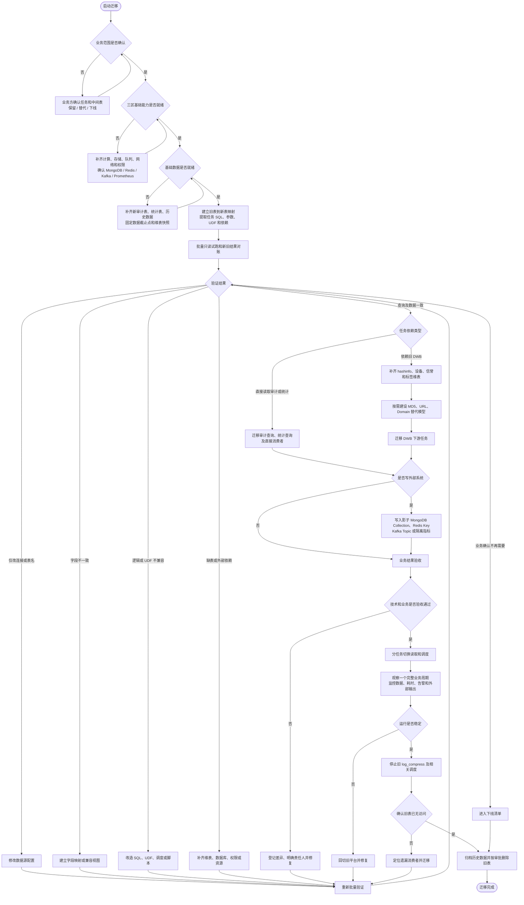
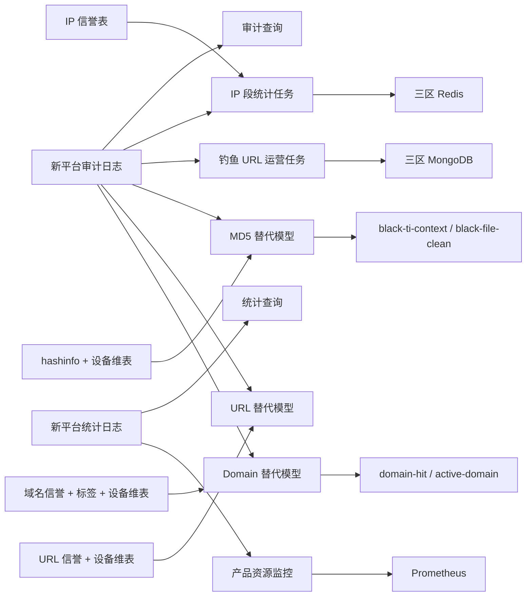

# 大数据平台迁移流程图

**文档日期：** 2026-09-09  
**范围：** 三区迁移；新平台目前已有审计日志数据，旧压缩日志表及其下游加工后续需要替代或下线。

## 关键数据依赖

## 使用说明

- 主流程中的循环表示：验证失败后先按原因修复，再进入同一批量验证通路。
- 新平台只有审计日志时，可以先推进审计查询；统计分支必须等待统计日志或替代模型。
- 依赖 MongoDB、Redis 等外部系统的任务，查询验证通过后仍需完成影子输出验证。
- 中间表是否重建由消费者和业务用途决定；确认不再需要的表直接进入下线清单。
- 旧任务先停止调度并观察访问，最后才归档或删除旧表。

## 关联文档

- `docs/大数据平台迁移困难点与阻塞项.md`
- `docs/YARN任务迁移顺序.md`
- `log/DATA_FLOW.md`

