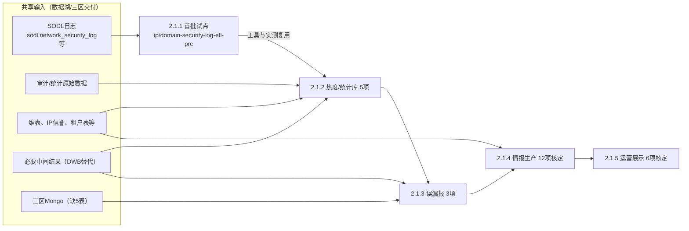

# 大数据迁移计划（三阶段）——金字塔叙事版

更新日期：2026-09-16。本版是《大数据迁移计划-三阶段.md》的重排稿：事实、工期、任务名与边界均沿用原文，只改组织方式（结论先行 → 三个支柱 → 逐层展开 → 边界与待确认集中收尾）。以哪一版为正式文本待用户确定。

---

## 0. 一页结论

**我们分三阶段，把确认保留的大数据任务从旧Hive平台迁到新平台/三区：前期准备约13.5个工作日（可并行压缩），执行阶段预算10人天按业务顺序分5批切换，每批切换后观察7个自然日，全部通过后退出旧任务。首批试点的实测结果决定后续排期。**

| 阶段     | 工期口径                            | 进入条件    | 完成标志                      | 牵头（待指定）            |
| ------ | ------------------------------- | ------- | ------------------------- | ------------------ |
| 一、前期准备 | 三块工作串行合计13.5工作日；允许并行，实际历时按人员容量排 | 开工日确定   | 首批任务可在测试环境跑通真实链路，输入已交付并校验 | 项目推动者、数据湖接口人、开发/测试 |
| 二、执行   | 10人天（工作量预算，非10个日历日）             | 准备关口通过  | 所有确认保留迁移项完成切换，未单列业务有处置结论  | 开发、测试、业务验收人        |
| 三、执行后  | 每批观察≥7自然日；老任务下线工期待确认            | 对应批次已切换 | 最后一批观察通过、旧依赖退出、交接签字       | 业务验收人、运维、数据湖       |

三件事决定这份计划能否兑现：**业务去留先定、共享输入先到、每批同一套验证**。下文按三阶段展开，每阶段先说结论，再说做法和完成标准。

### 背景与问题（SCQA）

- **现状**：45项盘点对象中有7项带退出相关标记，其余38项仍需核定范围；两张Mongo来源表已决定下线（DEC-001），`phishing-url-operation-prc`已确认下线（DEC-004）。
- **难点**：新平台没有压缩表和中间表，三区尚缺5个Mongo表；多数任务依赖共享输入（SODL日志、审计数据、维表、必要中间结果），业务顺序不能覆盖技术依赖。
- **问题**：在范围未完全锁定、输入未完全交付的情况下，如何安排一个可开工、可验证、可调整的迁移计划？
- **回答**：先用13.5工作日把"范围、输入、测试通路"三件事做实，再按业务优先级分批执行并逐批验证，最后按批观察、按批退出。

---

## 1. 前期准备：13.5工作日内做到"首批可跑通"

**结论：准备阶段不追求把所有数据迁好，只追求三个结果——范围清楚、首批输入到位、测试链路能跑真实任务。** 三块工作分别对应这三个结果。

| 块                 | 工期     | 解决的问题               | 完成标准                         |
| ----------------- | ------ | ------------------- | ---------------------------- |
| 1.1 任务对齐梳理        | 3工作日   | 迁什么、退什么、谁负责、怎么验     | 去留清单、表依赖清单、首批候选、业务验收标准       |
| 1.2 向数据湖交付需求与测试数据 | 3工作日   | 数据湖知道要给什么、按什么逻辑加工   | 测试表可访问，中间加工说明和责任边界确认，生产交付有日期 |
| 1.3 链路搭建与验证数据准备   | 7.5工作日 | 有环境、有样本、有基线，能做E2E验证 | 生产通路连通、E2E冒烟通过、测试集与基线齐备      |

完全串行为3＋3＋7.5＝13.5个工作日；1.2与1.3可与1.1已确认部分并行。

### 1.1 任务对齐梳理——3工作日

**结论：先把45项的去留和责任人定下来，未决项给负责人和期限，不默认下线。**

- [ ] 核对45项的实际运行情况、业务用途和读取方，区分保留迁移、退役、旁路/无需本次改造、待确认。
- [ ] 梳理所需迁移表：原始日志、基础表、维表、必要中间结果，落实生产者和消费者。
- [ ] 确认每项的业务负责人、任务负责人、验收人、重要性、结果口径、处理时效。
- [ ] 落实DEC-001两张下线表对`ctig`、`attack-ip`、`black-ti`及DataX相关分支的影响。
- [ ] 确认2.1.6中5项未归属业务的去留、交付时限和批次。

产出：任务去留清单、表依赖清单、首批候选、业务验收标准。

### 1.2 向数据湖交付需求与测试数据——3工作日（协助范围）

**结论：我方负责说清"要什么、怎么加工"，并搭出首批测试输入；接入开发、加工实现、历史回填由数据湖另列日期。**

- [ ] 构建测试环境所需迁移表数据——1工作日：确认目标表、字段映射、样例、更新规则，构建首批可用输入；与1.3数据收集用同一套样本。
- [ ] 中间表链路逻辑说明——2工作日：写清输入、关联、过滤、去重、聚合、输出粒度、发布时机，区分必要逻辑与取消逻辑，与数据湖确认承接边界。
- [ ] 实际接入开发、加工实现、历史回填、数据验收另列交付日期及负责人。

产出：测试表及初始数据可访问；中间加工说明与责任边界确认；生产交付有明确安排。

### 1.3 链路搭建与验证数据准备——7.5工作日

**结论：验证能力在准备阶段建好，执行阶段每批直接复用。**

| 子项            | 工期     | 做什么                                              | 完成标准                    |
| ------------- | ------ | ------------------------------------------------ | ----------------------- |
| 生产环境链路打通      | 0.5工作日 | 网络、账号、权限、连接与目标可达性检查                              | 生产通路连通记录                |
| 三区Mongo表新建及同步 | 1工作日   | 与春兰对齐数据格式和同步范围（集群/库/集合、业务键、字段、索引、更新删除规则）；三区尚缺5个表 | 目标可用、样例及同步检查通过；大规模回填另估  |
| 测试环境搭建验证通路    | 2工作日   | 输入→必要加工→真实任务→隔离Mongo/Redis/Kafka或其他输出→业务读取       | E2E冒烟通过，目标可重置、可读回，不影响生产 |
| 数据收集及测试集构建    | 3工作日   | 从获准生产数据收集表内样本、旧结果及必要日志，构造正常和异常场景                 | 同批输入下新旧结果可对账            |
| 现存数据每日生产情况统计  | 1工作日   | 建立旧任务产量、耗时、延迟、业务键覆盖和错误情况的基线                      | 逐任务基线报表和统计方式，后续按日采集     |

- [ ] 测试集覆盖新增、更新、删除、空结果、迟到、重试、补数、部分失败。
- [ ] 合成日志与真实生产样本分别标记：合成数据验证已知预期，真实快照做同窗口对账。
- [ ] 生产样本收集与测试通路搭建并行；目标读回验证等目标和输入就绪后进行。

### 1.4 准备完成关口

- [ ] 首批任务已确认保留、依赖和验收人，所需输入实际交付并校验。
- [ ] 测试环境能跑通真实业务链路，具备可比测试集、旧结果和输出读回能力。
- [ ] 后续批次的数据湖交付与必要中间加工有具体负责人、日期和验收方法。

---

## 2. 执行阶段：10人天，按业务顺序分5批，每批同一套验证

**结论：先用一个试点任务把工具、耗时和差异定位方法跑实，再按"热度库 → 误漏报 → 情报生产 → 运营展示"的业务优先级切换；任何批次的实际放行仍以上游数据和加工依赖就绪为前提。**

10人天是参与人员合计工作量：1人全职约10个工作日，2人理想并行约5个工作日，实际受中间结果依赖、验证运行时间、数据交付和切换窗口影响。覆盖范围：试点、各批改造、效果验证、问题修复、切换操作；准备、观察、下线另列。

### 2.1 业务顺序与技术依赖

箭头"B1 → B2 → B3 → B4"是业务优先顺序；竖向箭头是放行前必须就绪的输入。输入未到的批次顺延，已就绪的批次不等待。

### 2.1.1 首批试点——工期待试点范围确认

**结论：选一个依赖已齐、影响可控的任务，先把方法验证透，再复用到其他批。**

候选：若SODL先就绪，`ip-security-log-etl-prc`或`domain-security-log-etl-prc`（均读`sodl.network_security_log`，分别输出Redis和Mongo）。候选名单不等于切换批准。

- [ ] 完成字段/方言适配、固定窗口对账、目标读回、业务用例及性能验证。
- [ ] 测试切换边界与恢复能力，业务放行后切换并开始观察。
- [ ] 记录实际工作量、差异定位时间和性能，据此估算后续批次工期。

试点任务归属情报生产类，2.1.4统计时只计一次。

### 2.1.2 第一批：热度/统计库——5项

**结论：这5项直接支撑热度、活跃度与统计库生产，输入以审计数据和必要中间结果为主，压缩改原始的性能风险要在此批暴露。**

| 任务                              | 业务内容         | 去留状态   | 关键前置               | 目标输出          |
| ------------------------------- | ------------ | ------ | ------------------ | ------------- |
| `topthreat_hot_stat`            | 文件、URL、域名统计  | 按1.1核定 | 全部日志及混合来源分支        | 文件/Mongo（待核实） |
| `top-visit-host-produce-job`    | 访问TOP库、过滤包支撑 | 按1.1核定 | 输入日志、辅助数据          | Redis         |
| `filter-layout-ip-seg-stat-prc` | IP网段统计       | 保留     | 审计压缩输入替换、IP信誉、性能验证 | Redis         |
| `domain-heat-stats-cron-job`    | 域名热度库        | 待确认    | 必要中间结果先就绪          | Mongo         |
| `black-ti-context-produce-prc`  | 恶意IOC活跃统计    | 按1.1核定 | 所需DWB先验收；租户表潜在依赖核实 | Mongo/Redis   |

去留状态"按1.1核定"表示原文未标注，以1.1梳理结果为准。

- [ ] 先验输入和必要中间结果，再验消费及实际业务使用。
- [ ] 压缩改原始分支做规模性能验证。

### 2.1.3 第二批：误漏报治理——3项

| 任务                          | 业务内容         | 去留状态   | 关键前置             | 目标输出        |
| --------------------------- | ------------ | ------ | ---------------- | ----------- |
| `ati-pdns-cache-job`        | 过滤目的及业务归属待核实 | 待核实    | 输入就绪             | Mongo、Redis |
| `domain-hit-devnum-cronjob` | 命中设备数、降误报    | 按1.1核定 | Domain替代模型、Mongo | Mongo       |
| `black-file-clean-cronjob`  | 白文件列表清理      | 待确认    | MD5替代模型、文件云接口    | 文件云         |

`phishing-url-operation-prc`已确认下线（DEC-004），不在本批。

### 2.1.4 第三批：情报生产、研判与分发——12项核定

**结论：按业务分类中的12项逐项核定保留及是否涉及本次改造，扣除试点项后实施。**

- [ ] 处理攻击IP、域名/IP鉴定、回扫、检测输入和分发链路的完整输入与目标输出。
- [ ] `attack-ip-analysis-cronjob`落实skyeye IP表退出后的规则调整，按新业务标准验收。
- [ ] 旁路或无需本次平台改造的任务核实边界，不做换源迁移。

任务明细见[业务分类](./迁移任务按业务领域分类.md)。

### 2.1.5 第四批：运营展示——6项核定

- [ ] 核定`online-dev-warehousing-prc`、`cloud-display-manager-prc`、`dashboard-stats-job`、`cipd-product-resource-monitor-prc`、`svd-activity-stat-job`的迁移范围和去留。
- [ ] 校验在线设备、看板数据、监控指标、更新周期及展示结果。
- [ ] `thug-task-monitor-prc`有历史已下线记录，核实停用状态。

"运营展示最后切换"指业务任务切换顺序；迁移所需的运行监控、旧数据基线和告警从准备阶段开始。

### 2.1.6 待补批次归属——5项

`ctig-report-data-analysis-prc`、`yara-sample-query-job`、两个`cert-app-samplesync*`任务、`sp-old-update-report-cron-job`在本轮顺序中未单列，须在1.1梳理时确认去留、交付时限和插入批次。

公共接入和必要加工按受影响批次先行交付；维护类单独核定替代或退出；资产漏洞类和用途不明历史任务按退出清单处理。

### 2.2 每批同一套效果验证

**结论：五层检查、一套产出，关键差异解释闭环后才允许切换。**

| 层    | 检查内容                                                                  |
| ---- | --------------------------------------------------------------------- |
| 输入   | 完整性、字段、业务键、历史覆盖、增量时效                                                  |
| 中间结果 | 过滤、关联、去重、聚合、完整发布                                                      |
| 消费   | 业务对象、关键字段、统计值、缺失和重复                                                   |
| 目标端  | Mongo文档及更新删除；Redis Key/类型/值/TTL/旧Key清理；Kafka消息及真实消费效果；文件、指标、接口按实际接收验证 |
| 运行   | 每日产量、耗时、延迟对比；正常、峰值、重试、补数、恢复验证                                         |

对比在同一完整窗口、输入版本与目标初始状态下进行；已批准取消的表/分支导致的预期差异单独记录，由业务确认新验收标准。

每批产出：任务清单、版本、差异报告、性能结果、目标读回、业务验收、恢复演练、切换记录。切换时明确批次/位点和迟到归属，同范围单一有效写者；异常时停新写 → 恢复/补偿数据 → 恢复旧任务与读取 → 补边界对账。

---

## 3. 执行后：每批观察7自然日，全部通过后退出旧任务

**结论：观察按批独立计时，下线以全部保留消费者退出为前提。**

### 3.1 业务观测——每批≥7自然日

- [ ] 每批从自身切换日起观察至少7个自然日；最终收口以最后一批通过为准。
- [ ] 观察产量、时效、业务读取、重试、补数、资源和告警。
- [ ] 低频业务覆盖约定实际周期或业务认可的等价演练，不足时延长。
- [ ] 业务验收人签署观察结论，关键问题闭环。

### 3.2 老任务下线——工期待确认

- [ ] 停止获批旧实例和调度；保留恢复版本、旧输入及数据保留期安排。
- [ ] 检查共享旧接入、中间加工、Hive查询和中转供数；全部保留消费者退出后再停共享上游。
- [ ] 核实历史已下线任务，完成新增退役项的执行记录和输出影响处理。
- [ ] 完成监控、告警、故障处置及负责人交接。

产出：业务观察签字、旧依赖退出报告、停调度记录、运行交接。

---

## 4. 阶段检查节点（唯一关口表）

| 节点       | 必须拿到的检验结果                                  |
| -------- | ------------------------------------------ |
| 准备完成     | 首批范围明确、输入验收通过、生产连通与测试E2E通路具备、可复现测试集和生产基线齐备 |
| 试点完成     | 查询、目标读回、业务用例、性能及恢复能力通过，形成后续实测排期            |
| 每个业务批次完成 | 保留任务及分支全部覆盖，每项质量验收和切换有证据；试点不重复计            |
| 执行阶段完成   | 所有确认保留迁移项已切换；2.1.6五项有处置结论                  |
| 项目收口     | 最后一批观察通过、旧依赖退出、退役项完成、交接签字                  |

---

## 5. 口径、边界与待确认（集中说明）

原文散布在各节的边界声明集中于此，语义不变。

**时间口径**

- 准备阶段"工作日"、观察"自然日"、执行"人天"三种单位各自独立，不互相换算。
- 13.5工作日是串行合计，不是已确认人日投入或项目总工期。
- 10人天是暂定预算（DEC-006），未经试点实测；范围或实测变化时追加调整依据，不以预算省略验收。
- 旧版"25个工作日完成切换"的估算不作为本计划承诺。
- 原文第3章标题标注"2d"，本版未保留：用户三阶段安排（DEC-005）只记载"观察7d及老任务下线"，2d来源待确认。

**范围口径**

- 45项是盘点全集；7项退出相关标记不全是已完成下线，38项也不等于全部需要改造。
- "5项热度库安排"不等于5项去留均已确认；`domain-heat`、`black-file`去留待确认。
- 试点任务归情报生产类，只计一次。
- 数据湖3工作日是协助范围，不等于生产接入、加工和历史回填完成；未完成的交付会阻塞依赖它的批次。
- 停止任务不等于删除数据；我方退出不等于全平台下线。
- 行数一致不能单独证明正确。

**待确认项**

| 事项                                                  | 状态           |
| --------------------------------------------------- | ------------ |
| 开工日、各阶段负责人、资源投入                                     | 待落实          |
| 数据湖各表交付日期、三区5个缺表同步安排                                | 待落实（ACT-007） |
| 首批试点候选：追踪文件DEC-005记载"首选gnn、备选IP/域名ETL"，原文只列IP/域名ETL | 两处需对齐        |
| 老任务下线工期                                             | 待确认          |
| 2.1.6五项的批次归属                                        | 1.1梳理时确认     |

---

## 6. 关联材料

- [原版三阶段计划](./大数据迁移计划-三阶段.md)
- [任务业务分类及退出标记](./迁移任务按业务领域分类.md)
- [详细执行检查项参考](./大数据迁移执行计划-大任务与子项.md)
- [事项进度与决策追踪](./迁移事项进度与决策追踪.md)（DEC-001、DEC-004、DEC-005、DEC-006、ACT-007）

